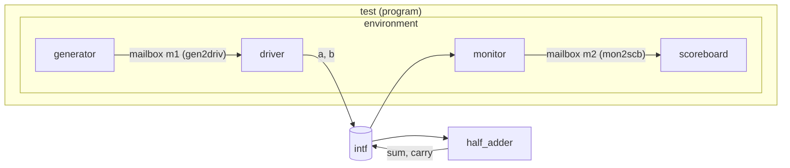

# Half Adder – Layered SystemVerilog Testbench

A class-based, layered SystemVerilog testbench (generator → driver → monitor → scoreboard, connected with mailboxes) that verifies a gate-level half adder.


## Architecture



| Layer | File | Role |
|---|---|---|
| Transaction | `tb/transaction.sv` | Randomised inputs `a`, `b`; holds `sum`, `carry`; `display()` helper |
| Generator | `tb/generator.sv` | Creates and randomises a transaction, puts it in `gen2driv` |
| Driver | `tb/driver.sv` | Gets a transaction and drives `a`, `b` onto the interface |
| Monitor | `tb/monitor.sv` | Samples the interface after `#3` and sends it to `mon2scb` |
| Scoreboard | `tb/scoreboard.sv` | Checks `sum == a ^ b` and `carry == a & b` |
| Environment | `tb/environment.sv` | Builds the components and mailboxes, runs them in a `fork…join` |
| Test | `tb/test.sv` | `program` that creates the environment and calls `run()` |
| Interface | `tb/interface.sv` | Signals `a`, `b`, `sum`, `carry` |
| Top | `tb/testbench.sv` | `tbench_top`: instantiates the interface, test and DUT; dumps `dump.vcd` |
| DUT | `rtl/half_adder.sv` | `xor` + `and` gate half adder |

## Repository layout

```
.
├── rtl/
│   └── half_adder.sv
├── tb/
│   ├── testbench.sv     # top module (tbench_top)
│   ├── test.sv
│   ├── environment.sv
│   ├── generator.sv
│   ├── driver.sv
│   ├── monitor.sv
│   ├── scoreboard.sv
│   ├── transaction.sv
│   └── interface.sv
├── files.f              # file list (+incdir+tb)
└── Makefile
```

## Running

The testbench uses classes, mailboxes, randomisation and a `program` block, so it needs a full SystemVerilog simulator (it was run on Synopsys VCS on EDA Playground).

```sh
make vcs       # Synopsys VCS
make questa    # Siemens Questa / ModelSim
make xcelium   # Cadence Xcelium
make clean
```


### Expected output

```
-------------------------
 Generator
-------------------------
a = ?,   b = ?
...
Result is as Expected
-------------------------
 Scoreboard
-------------------------
```

The values of `a` and `b` are random each seed, and the testbench runs one transaction (`repeat(1)`); increase the repeat count in the generator, driver, monitor and scoreboard to run more.
